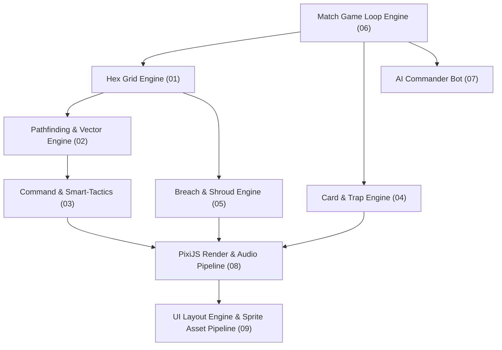

# 🛠️ AUROLITH — TECHNICAL MASTER ROADMAP & ENGINE ARCHITECTURE

> Complete engineering blueprint for building the **Aurolith** (formerly General Gilded) 2.5D Isometric Web RTS / Deckbuilder game engine.

> **Start with [[14 - Implementation Roadmap, Authority & Decision Log]].** It defines rule authority, `shared/client/server` ownership, delivery stages and open design conflicts. This index maps subsystem specifications; it is not a requirement to implement all subsystems at once.
> The per-stage execution checklists are at [`Plan/Stages/build-process.md`](../Stages/build-process.md).

---

## ⚡ Technical Specification Index

| File | Subsystem | Engineering Core |
| :--- | :--- | :--- |
| `[[01 - Hex Grid Engine & Coordinate Systems]]` | **Grid & Spatial Engine** | Axial/Cube hex coordinates, 90×150 grid data structures, screen-to-hex conversion, tether leashes. |
| `[[02 - Pathfinding, Drag-Vector & Movement Engine]]` | **Pathfinding & Vectoring** | Flow Field pathfinding, drag-and-draw movement vectors, flocking, 4 platoons of 5 units (20 cap), vector chevron trails (`>>>`) & dynamic convex hulls. |
| `[[03 - Command Priority Queue & Smart-Tactics AI]]` | **Command & Skill AI** | 4-platoon hotkeys (`1–4`), 3 Observable Stances (`A`,`D`,`R`), 3 Focus Directives (`Z`,`X`,`C`), 55% Ally HP Peel & Assassin counter, Smart-Tactics AI. |
| `[[04 - Card System, Draw Ticker & Trap Manager]]` | **Card & Trap Engine** | 2:30 cadence ticker, milestone bonus draws, 6-card hand, 0-gold free cast, 15s action overflow buffer, explicit card targeting scopes (Platoon, AoE Hex, Structure, Global). |
| `[[05 - Structure Breach, Bottlenecks & Shroud Masking]]` | **Structures & Shroud** | 6-hex segment HP tracking, Demolition Sapping (-70% non-siege decays 5%/15s), Castle Core Desperation Battery tethered to Arcane Barrier, 50% refund, Hotseat FoW. |
| `[[06 - Match Game Loop, Phases & Overtime Engine]]` | **Match Game Loop** | Fixed-tick 18m simulation, 3 In-Match Blessing Rites (0:00, 5:00, 10:00), mode pause and core-rule victory. |
| `[[07 - AI Commander Bot State Machine]]` | **AI Commander Bot** | Heuristic utility decision tree for 4-platoon role allocation, stance switching (`A/D/R`), jungle farming, facility construction, spell heatmaps. |
| `[[08 - Audio Engine & Visual Render Pipeline]]` | **Render & Audio Engine** | PixiJS 2.5D Isometric viewport, Retina scaling, frustum culling, `YSortedWorldContainer`, BitmapText, 16-channel audio. |
| `[[09 - UI Layout Engine & Sprite Asset Pipeline]]` | **UI Engine & Atlases** | PixiJS world overlays, DOM information panels, profiled sprite atlases and one-way view-state binding. |
| `[[11 - Unit Model Visual Art Direction]]` | **Models & Animation** | 80-unit art direction (8 classes), universal 8-state animation template, quality/state visual language, sprite atlas pipeline. |
| `[[12 - Client Architecture, Tech Stack & UX Panel System]]` | **Client & UX** | Full-stack TypeScript monorepo (shared/client/server), Vite + PixiJS v8, Teamfight Manager-style screen layout, 4-Platoon Roster Panel (HP + skill-readiness monochrome rule, 1-click stance toggles), bottom dock, hotkey mandate (`1–4`, `A/D/R`, `Z/X/C`, `Q/W/E`). |
| `[[13 - Networking & Authoritative Server]]` | **Networking** | Node.js authoritative WebSocket server, filtered player views, reconnect and bounded updates. |
| `[[14 - Implementation Roadmap, Authority & Decision Log]]` | **Delivery & decisions** | Vertical slice, stage gates, source authority, open conflicts and Jev-backed decision log. |

---

## 🏗️ System Architecture Diagram

